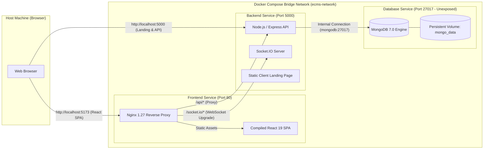

# Event Crowd Management System (ECMS)

A production-ready Event Crowd Management System built on the MERN stack (MongoDB, Express, React, Node.js) featuring real-time Socket.IO live analytics, QR-code ticket verification, Razorpay payments, and venue capacity alerting.

---

## Architecture Overview



---

## 1. Prerequisites

Before running the application with Docker, ensure the following are installed and running:

1. **Docker Desktop**:
   - Ensure Docker Desktop is installed on Windows.
   - Start Docker Desktop and verify the Docker engine is running by executing:
     ```powershell
     docker info
     ```
2. **Docker Compose**: Included by default in Docker Desktop (`v2.20+` or `v5+`).
   ```powershell
   docker compose version
   ```
3. **Node.js** (Optional for local development without containers):
   - Node.js LTS (v20 or v22) & npm v10+.

---

## 2. Environment Variables Configuration

The repository includes a safe template file: `.env.example`.

### Setting Up `.env`
In Windows PowerShell at the repository root, create your `.env` file from the example:

```powershell
Copy-Item .env.example .env
```

Open `.env` and configure your credentials:

| Variable | Description | Default in Docker Compose |
| :--- | :--- | :--- |
| `NODE_ENV` | Application environment mode | `production` |
| `PORT` | Backend internal port | `5000` |
| `BACKEND_PORT` | Host port mapped to backend | `5000` |
| `FRONTEND_PORT` | Host port mapped to frontend | `5173` |
| `MONGO_URI` | MongoDB connection URI | `mongodb://mongodb:27017/eventcrowd` |
| `JWT_SECRET` | Secret key for JWT signing & QR validation | *Required - Set a 32+ character random key* |
| `RAZORPAY_KEY_ID` | Razorpay Key ID (Test/Live) | *Required for payments* |
| `RAZORPAY_KEY_SECRET` | Razorpay Secret Key | *Required for payments* |
| `RAZORPAY_WEBHOOK_SECRET` | Razorpay Webhook Secret | *Optional* |
| `VITE_SOCKET_URL` | Socket.IO URL accessed by browser | `http://localhost:5000` |

> **Security Note:** Never commit your `.env` file to Git. The root `.gitignore` explicitly prevents `.env` and `.env.*` from being tracked.

---

## 3. Starting the Application with Docker Compose

To build images and start all three services (`frontend`, `backend`, `mongodb`) in detached mode:

```powershell
docker compose up --build -d
```

### Checking Service Health & Logs

Check the status of running containers:
```powershell
docker compose ps
```

Tail real-time logs for all services:
```powershell
docker compose logs -f
```

Tail logs for a specific service:
```powershell
docker compose logs -f backend
docker compose logs -f frontend
docker compose logs -f mongodb
```

### Accessing the Running Applications

Once containers show as `healthy`:
- **React Management SPA Dashboard**: [http://localhost:5173](http://localhost:5173)
- **Public Client Landing Page**: [http://localhost:5000](http://localhost:5000)
- **API Health Check**: [http://localhost:5000/api-status](http://localhost:5000/api-status)
- **REST API Base**: [http://localhost:5000/api](http://localhost:5000/api)

---

## 4. Seeding Initial Data in Docker

To seed sample events and user accounts into the containerized MongoDB instance:

```powershell
docker compose exec backend node utils/seed.js
```

---

## 5. Stopping Containers & Preserving Data

### Stop Containers (Preserves MongoDB Data)
To gracefully stop all containers while keeping database records safe in the persistent Docker volume (`mongo_data`):

```powershell
docker compose down
```

### Stop Containers and Wipe Data (Clean Reset)
If you need a complete clean slate (including erasing MongoDB data):

```powershell
docker compose down -v
```

---

## 6. Running Local Verification & Tests

To execute code quality checks locally before pushing:

### Frontend Linting & Build Check
```powershell
cd "event crowd/frontend"
npm run lint
npm run build
cd ../..
```

### Backend Syntax & Import Validation
```powershell
cd "event crowd/backend"
node --check server.js
cd ../..
```

### Docker Compose Syntax Validation
```powershell
docker compose config
```

---

## 7. GitHub Actions CI/CD Pipeline

The automated CI/CD workflow is defined in [`.github/workflows/ci-cd.yml`](.github/workflows/ci-cd.yml).

### Pipeline Stages

1. **`code-quality-and-build` Job**:
   - Triggers on all pushes and pull requests to `main`.
   - Sets up Node.js 20 with dependency caching.
   - Runs `npm ci` on frontend and backend using lockfiles.
   - Executes Oxlint (`npm run lint`) and Vite build (`npm run build`) on frontend.
   - Executes syntax & module integrity verification (`node --check server.js`) on backend.
2. **`docker-validation` Job**:
   - Runs after code quality passes.
   - Validates the `docker-compose.yml` specification (`docker compose config`).
   - Builds both frontend and backend Docker images using Docker Buildx and GitHub Actions cache (`type=gha`).
3. **`publish-images` Job (Optional GHCR Publishing)**:
   - Executes only on pushes to `main` when all prior checks pass.
   - Authenticates to GitHub Container Registry (`ghcr.io`) using the built-in `GITHUB_TOKEN`.
   - Publishes images:
     - `ghcr.io/<owner>/ecms-backend:latest`
     - `ghcr.io/<owner>/ecms-frontend:latest`
     - Image tags with git commit SHA for immutable deployments.

### Configuring GHCR Publishing
1. Ensure GitHub Actions has read and write permissions for Packages under:
   `Repository Settings` -> `Actions` -> `General` -> `Workflow permissions` -> select **Read and write permissions**.
2. No paid subscriptions or third-party registry accounts are required; GHCR is built into GitHub.

---

## 8. Common Troubleshooting Commands

### 1. Port Conflict (`Bind for 0.0.0.0:5000 failed: port is already allocated`)
Identify which process is using the port on Windows:
```powershell
Get-NetTCPConnection -LocalPort 5000, 5173 -ErrorAction SilentlyContinue | Format-Table OwningProcess, LocalPort, State
```
Stop the conflicting process or run `.\start.bat` cleanup logic, or change `FRONTEND_PORT` or `BACKEND_PORT` in your `.env`.

### 2. MongoDB Unhealthy or Failing to Start
Inspect the MongoDB container log:
```powershell
docker compose logs mongodb
```
If corrupt data exists from an unclean shutdown, recreate the volume:
```powershell
docker compose down -v
docker compose up --build -d
```

### 3. Rebuild Containers After Code Changes
Force a fresh rebuild without using cached layers:
```powershell
docker compose build --no-cache
docker compose up -d
```

### 4. Interactive Shell into Containers
Inspect container filesystem or run commands:
```powershell
# Backend container shell
docker compose exec backend sh

# Frontend container shell
docker compose exec frontend sh

# MongoDB shell
docker compose exec mongodb mongosh eventcrowd
```
